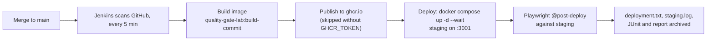

# Post-merge: deploy to staging and smoke test (Jenkins)

One flow only: **a merge to `main` is built into an image, deployed to staging, and verified.** Pull-request checks live in the sibling repos `qg-pr-open-e2e-playwright` (source) and `qg-pr-open-container-playwright` (container image).

## Why this check exists

PR checks prove the code and the image work in a clean CI environment. They cannot prove the *deployment* works. The post-deploy smoke catches what only shows up in the real environment: wrong config or volume, a deploy that never updated the service, an unhealthy container, ports and networking, and test-only features accidentally left on (the tests assert `POST /api/test/reset` returns 404).

## The flow



| Stage | What it does | Fails when |
|---|---|---|
| Prepare | Computes `VERSION` (`<build>-<commit>`), installs the E2E project and Chromium | Install fails |
| Build image | `docker build` from the `Dockerfile` | The image does not build |
| Publish image | Pushes to `ghcr.io` if `GHCR_TOKEN` is set | Login or push fails |
| Deploy to staging | `docker compose -f docker-compose.staging.yml up -d --wait` | The container never becomes healthy |
| Post-deploy smoke | `@post-deploy` tests with `BASE_URL=http://host.docker.internal:3001` | The deployed app misbehaves |

The `Jenkinsfile` gates every stage on `branch 'main'`, so other branches build nothing. There are no unit tests or full E2E here by design; those belong to the PR flows.

## Key ideas

- **Staging is a running Compose stack** (`qgl-staging`, port 3001, persistent volume), not a branch. Jenkins deploys the image it just built, and the same image would be promoted to production.
- **Jenkins can deploy because it mounts the host Docker socket**, so containers it starts run beside it on your Docker.
- **The post-deploy tests never reset data.** The reset endpoint is off in staging.

## What's in the repo

| Path | Purpose |
|---|---|
| `Jenkinsfile` | The pipeline above |
| `docker-compose.staging.yml` | The staging stack |
| `Dockerfile`, `apps/` | The sample app being deployed |
| `e2e/` | Playwright project; only the two `@post-deploy` specs are kept |
| `jenkins/` | Local Jenkins controller as code (Configuration as Code) |

## Run it

1. Copy `jenkins/.env.example` to `jenkins/.env`; set `JENKINS_ADMIN_PASSWORD` and a read-only `GITHUB_TOKEN`. Optional: `GHCR_TOKEN` (classic, `write:packages`).
2. `docker compose -f jenkins/docker-compose.yml up --build -d`, then open http://localhost:8080.
3. Push this repo to GitHub as `davidlescard/qg-post-merge-staging-jenkins` (the job in `jenkins/casc/jenkins.yaml` points there), then merge to `main`.

This Jenkins uses the same container name and port as the one in `ai-ci-reference-dashboard`, so run only one at a time. Both also use staging port 3001.

Run the smoke by hand against any environment:

```
BASE_URL=http://localhost:3001 pnpm --filter ai-ci-reference-e2e test:post-deploy
```

Tear down staging: `APP_IMAGE=x docker compose -p qgl-staging -f docker-compose.staging.yml down`.
