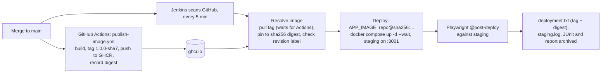

# Post-merge: deploy to staging and smoke test (Jenkins)

One flow only: **a merge to `main` produces a versioned image in GHCR, Jenkins deploys that exact image to staging by digest, and verifies it.**
Pull-request checks live in the sibling repos `qg-pr-open-e2e-playwright` (source) and `qg-pr-open-container-playwright` (container image). The step-by-step code path is in [VERBOSE.post-merge-staging.md](VERBOSE.post-merge-staging.md).

## Why this check exists

PR checks prove the code and the image work in a clean CI environment. They cannot prove the *deployment* works. The post-deploy smoke catches what only shows up in the real environment: wrong config or volume, a deploy that never updated the service, an unhealthy container, ports and networking, and test-only features accidentally left on (the tests assert `POST /api/test/reset` returns 404).

## The flow



Responsibilities are split the way many enterprises split them: **CI builds and publishes, CD deploys.** Jenkins never runs `docker build`.

### GitHub Actions: `.github/workflows/publish-image.yml` (push to `main`)

| Step | What it does |
|---|---|
| Compute image tag | Reads `version` from `package.json` and appends the short commit: `1.0.0-a1b2c3d` |
| Build and push | Builds the `Dockerfile`, pushes `ghcr.io/davidlescard/qg-post-merge-staging-jenkins:<tag>` with the built-in `GITHUB_TOKEN`, and adds OCI labels (`version`, `revision` = full commit, `source`) |
| Record the image digest | Writes `image.txt` (version, tag, digest, `repo@digest`, commit) to the job summary and as the `image` artifact |

### Jenkins: `Jenkinsfile` (`main` only)

| Stage | What it does | Fails when |
|---|---|---|
| Prepare | Computes the same tag from `package.json` and `GIT_COMMIT`; installs the E2E project and Chromium | Install fails |
| Resolve image | Pulls the tag, retrying for up to 10 minutes while Actions finishes; resolves it to `repo@sha256:...`; checks the image's `revision` label equals the commit | The image never appears, or it was built from a different commit |
| Deploy to staging | `APP_IMAGE=<repo@digest> docker compose -f docker-compose.staging.yml up -d --wait` | The container never becomes healthy |
| Post-deploy smoke | `@post-deploy` tests with `BASE_URL=http://host.docker.internal:3001` | The deployed app misbehaves |

The `Jenkinsfile` gates every stage on `branch 'main'`, so other branches do nothing. There are no unit tests or full E2E here by design; those belong to the PR flows.

## Key ideas

- **Tag to find, digest to deploy.** The tag `1.0.0-a1b2c3d` is human-readable and is how Jenkins finds the image for its commit. Tags can be moved, so Jenkins immediately pins it to the immutable `sha256` digest, and staging runs `repo@sha256:...`. `deployment.txt` records both.
- **The version is the app's.** Bump `version` in `package.json` to release a new version; the commit suffix keeps every build unique.
- **Staging is a running Compose stack** (`qgl-staging`, port 3001, persistent volume), not a branch.
- **Jenkins can deploy because it mounts the host Docker socket**, so containers it starts run beside it on your Docker.
- **The post-deploy tests never reset data.** The reset endpoint is off in staging.

## What's in the repo

| Path | Purpose |
|---|---|
| `.github/workflows/publish-image.yml` | Builds and publishes the image to GHCR |
| `Jenkinsfile` | Resolves, deploys and verifies the image |
| `docker-compose.staging.yml` | The staging stack |
| `Dockerfile`, `apps/` | The sample app being deployed |
| `package.json` | Holds the app `version` used in the image tag |
| `e2e/` | Playwright project; only the two `@post-deploy` specs are kept |
| `jenkins/` | Local Jenkins controller as code (Configuration as Code) |

## Run it

1. Copy `jenkins/.env.example` to `jenkins/.env`; set `JENKINS_ADMIN_PASSWORD`, `GITHUB_USER` and a read-only `GITHUB_TOKEN`. No registry token is needed.
2. `docker compose -f jenkins/docker-compose.yml up --build -d`, then open http://localhost:8080.
3. Push to `main`. After the first publish, make the GHCR package public once: GitHub > your profile > Packages > `qg-post-merge-staging-jenkins` > Package settings > Change visibility > Public. Until then, Jenkins' anonymous pull fails.

This Jenkins uses the same container name and port as the one in `ai-ci-reference-dashboard`, so run only one at a time. Both also use staging port 3001.

Check what staging is running:

```
docker inspect qgl-staging-app-1 --format "{{.Config.Image}}"
```

Run the smoke by hand against any environment:

```
BASE_URL=http://localhost:3001 pnpm --filter ai-ci-reference-e2e test:post-deploy
```

Tear down staging: `APP_IMAGE=x docker compose -p qgl-staging -f docker-compose.staging.yml down`.
