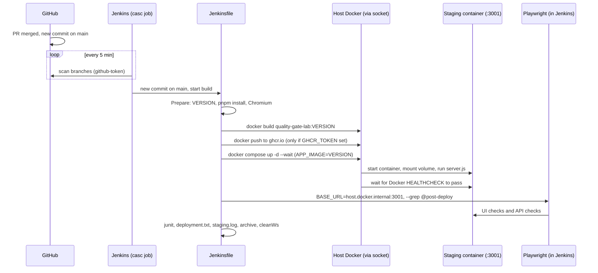

# Verbose: merge to main, deploy to staging, smoke test (Jenkins)

This expands the flow described in [README.md](README.md). It follows the code path from a merge to `main` through to the archived results, and names every file and line that runs.

## The path at a glance

## Step by step

### 0. Trigger: how Jenkins notices the merge
[jenkins/casc/jenkins.yaml](jenkins/casc/jenkins.yaml)

- The `jobs:` block creates the multibranch pipeline `qg-post-merge-staging` when Jenkins starts. Nobody creates it by hand.
- `branchSources` points at `davidlescard/qg-post-merge-staging-jenkins` using the `github-token` credential. `buildOriginBranch(true)` builds branches; `buildOriginBranchWithPR(false)` and `buildOriginPRMerge(false)` turn off pull request builds, because PR checks belong to the other repos.
- `periodicFolderTrigger { interval('5m') }`: Jenkins polls GitHub every 5 minutes. There is no webhook, because GitHub cannot reach a Jenkins on your machine.
- `numExecutors: 1`: only one build runs at a time, so two builds never fight over staging port 3001.
- The credentials `github-token` and `ghcr-token` are created at startup from environment variables ([jenkins/.env](jenkins/.env.example) via [jenkins/docker-compose.yml](jenkins/docker-compose.yml)). An empty `GHCR_TOKEN` is allowed.

When a new commit appears on `main`, Jenkins starts a build that reads the repo's `Jenkinsfile`.

### 1. Pipeline setup
[Jenkinsfile](Jenkinsfile)

- Line 2: `agent any` runs on the only node, the Jenkins controller itself.
- Lines 6-10: `options`: timestamps in the log, a 20-minute cap, `disableConcurrentBuilds(abortPrevious: true)` so a newer build aborts an older one, and only the last 20 builds (5 with artifacts) are kept.
- Lines 13-17: `environment`: `CI=true` (switches Playwright to CI behaviour), the registry name, and `STAGING_URL`. The URL uses `host.docker.internal` because staging is published on the *host's* port 3001, not on Jenkins' own network. The compose file maps that name to the host through `extra_hosts` ([jenkins/docker-compose.yml lines 16-17](jenkins/docker-compose.yml#L16-L17)).

### 2. The tools Jenkins brings
[jenkins/Dockerfile](jenkins/Dockerfile)

The Jenkins image is built to contain everything the pipeline calls:
- Lines 4-12: the Docker CLI and Compose plugin. They talk to your host's Docker daemon through the mounted socket (`/var/run/docker.sock` in [docker-compose.yml line 20](jenkins/docker-compose.yml#L20)), so containers started here run beside Jenkins, not inside it.
- Lines 14-17: Node 24 and pnpm 12.14.0, the same pnpm version as the app.
- Lines 19-23: the operating-system libraries Chromium needs. The browser itself is downloaded by the pipeline and cached in the Jenkins volume.
- [docker-compose.yml line 6](jenkins/docker-compose.yml#L6): `user: root` so the container may use the socket. This is a lab shortcut.

### 3. Stage: Prepare
Jenkinsfile lines 20-30.

- Line 22: `when { branch 'main' }`. On any other branch the stage is skipped, and so is every later stage.
- Lines 24-26: set `VERSION` to `<build number>-<first 7 characters of the commit>`, for example `12-a1b2c3d`. This version names the image, so you can always tell which commit is in staging.
- Line 28: `pnpm install --frozen-lockfile --filter ai-ci-reference-e2e` installs only the test project. The app's own dependencies are not needed here, because the app is built inside the image.
- Line 29: downloads Chromium at the version matching `@playwright/test`.

### 4. Stage: Build image
Jenkinsfile lines 33-38. `docker build -t "quality-gate-lab:${VERSION}" .` builds the app from the [Dockerfile](Dockerfile) with the host's daemon. This is the same two-stage build as in the container PR repo:
- **Stage 1** ([Dockerfile](Dockerfile#L1-L10)): installs everything and runs `pnpm run build`, which compiles the React site to `apps/web/dist` and the API to `apps/api/dist`.
- **Stage 2** (lines 12-27): a fresh Node image with only production dependencies and the two built folders, running as the non-root `node` user. Line 26 is the Docker `HEALTHCHECK`, which fetches `/health` every 5 seconds. Line 27 starts `node apps/api/dist/server.js`.

No tests run here. The image was already tested at PR time; this build creates the artifact that will be deployed.

### 5. Stage: Publish image
Jenkinsfile lines 40-58.

- Line 43: `withCredentials` loads the `ghcr-token` credential into `GHCR_USER` and `GHCR_PASS`, and Jenkins masks the password in the log.
- Lines 45-48: if the token is empty, print a message and `exit 0`. The stage passes without pushing, and staging uses the locally built image.
- Lines 49-54: otherwise log in to `ghcr.io`, tag the image as `${IMAGE_REPO}:${VERSION}` and `:latest`, push both, and log out.

The staging deploy in the next stage uses the *local* tag, not the registry copy. Publishing is a side effect of this pipeline; it does not feed the deploy.

### 6. Stage: Deploy to staging
Jenkinsfile lines 60-66, [docker-compose.staging.yml](docker-compose.staging.yml).

- Line 64: `APP_IMAGE="quality-gate-lab:${VERSION}" docker compose -f docker-compose.staging.yml up -d --wait`.
- [Compose file](docker-compose.staging.yml): the project name is `qgl-staging`. The single service `app` takes its image from `APP_IMAGE` (the `:?` makes Compose refuse to start if it is unset), publishes host port `3001` to the container's `3000`, restarts unless stopped, and mounts the named volume `staging-data` at `/data`.
- Re-running `up` with a new `APP_IMAGE` replaces the old container with one from the new image. This is the deploy.
- `/data` holds the SQLite file (`DB_PATH=/data/app.db`), so **staging data survives deploys**. Seed data is inserted only the first time ([seed.ts](apps/api/src/seed.ts) `seedIfEmpty`).
- `--wait` makes Compose block until the container's Docker `HEALTHCHECK` reports healthy. If it never does, Compose exits non-zero and the stage fails. This is the first post-deploy check, and it comes free from the Dockerfile.
- `ENABLE_TEST_RESET` is not set, so `POST /api/test/reset` does not exist ([app.ts lines 82-87](apps/api/src/app.ts#L82-L87)) and falls through to the 404 handler (line 89-91).

### 7. Stage: Post-deploy smoke
Jenkinsfile lines 68-77.

- Runs `playwright test --grep @post-deploy` with `BASE_URL=http://host.docker.internal:3001`, so only tests tagged `@post-deploy` run, against staging.
- [e2e/playwright.config.ts](e2e/playwright.config.ts): two projects, `ui` (Desktop Chrome) and `api` (no browser). `retries` is 1 when `CI` is set. The JUnit reporter writes `e2e/test-results/junit.xml`.
- [e2e/src/fixtures/baseTest.ts](e2e/src/fixtures/baseTest.ts): because `BASE_URL` is set, the worker fixture returns `external: true` and does not start any local server (lines 33-36). The `resetData` fixture (lines 62-71) skips the reset for an external target unless `ALLOW_TEST_RESET` is set, and Jenkins does not set it. Staging data is therefore never touched.
- [post-deploy.spec.ts](e2e/tests/ui/post-deploy.spec.ts): loads the dashboard, checks the heading and table columns, and requires at least one data row.
- [post-deploy.api.spec.ts](e2e/tests/api/post-deploy.api.spec.ts):
  - `/health` and `/api/health` both return `{ "status": "ok" }`.
  - `/api/runs` returns a non-empty list.
  - `POST /api/test/reset` returns **404**. This guards against a test-only endpoint leaking into a deployed environment.

If any test fails, the stage fails, and so does the build.

### 8. Post actions
Jenkinsfile lines 80-92 (`post { always { ... } }`), which run whether the build passed or failed.

- Line 82: publish `e2e/test-results/junit.xml` as test results. `allowEmptyResults` keeps the step quiet when no tests ran.
- Lines 83-88: on `main`, write `deployment.txt` (version, image, commit, URL, result) and set the build description to e.g. `12-a1b2c3d to staging: SUCCESS`. This is the deployment record.
- Line 89: `docker logs qgl-staging-app-1 > staging.log`. This is Compose's default container name (`<project>-<service>-<index>`), and `|| true` stops a missing container from failing the step. If you change the project or service name, update this line.
- Line 90: archive `staging.log`, `deployment.txt`, the Playwright report and the traces.
- Line 91: `cleanWs()` empties the workspace.

The staging container and its image are **not** removed. Staging is meant to keep running after the build.

## What this proves, and what it does not

| Question | Answered by |
|---|---|
| Did the image build from the merged commit? | Build image stage |
| Did the new image start and become healthy with the staging config and volume? | `up -d --wait` |
| Does the deployed app answer on its real port? | `/health` tests |
| Does the UI render data from the deployed API? | UI test |
| Is the test-only reset endpoint absent? | The 404 test |
| Is the code correct? Is the image sound before merge? | Not here. See the PR repos |
| Is it safe for production? | Not here. There is no production stage or approval step |

## Files that run, in order

| Order | File | Role |
|---|---|---|
| 1 | `jenkins/casc/jenkins.yaml` | Creates the job, credentials and 5-minute polling |
| 2 | `jenkins/Dockerfile`, `jenkins/docker-compose.yml`, `jenkins/plugins.txt` | The Jenkins controller and its tools |
| 3 | `Jenkinsfile` | The pipeline |
| 4 | `Dockerfile`, `.dockerignore` | Build the image |
| 5 | `apps/web/*`, `apps/api/src/*` | The app that gets built and run |
| 6 | `docker-compose.staging.yml` | The staging stack |
| 7 | `e2e/playwright.config.ts`, `e2e/src/*` | Test configuration, fixture and page objects |
| 8 | `e2e/tests/ui/post-deploy.spec.ts`, `e2e/tests/api/post-deploy.api.spec.ts` | The smoke tests |

Not used in this path: `apps/api/test/` (Mocha tests), `build.sh` (convenience for local runs), and any GitHub Actions workflow.
