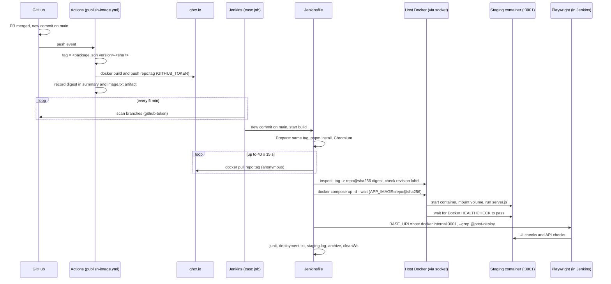

# Verbose: merge to main, publish to GHCR, deploy to staging by digest, smoke test

This expands the flow described in [README.md](README.md). It follows the code path from a merge to `main` through to the archived results, and names every file and line that runs. Two systems take part: **GitHub Actions builds and publishes the image**, and **Jenkins deploys and verifies it**.

## The path at a glance

Actions and Jenkins both start from the same merge but do not talk to each other. **The image tag is the contract between them:** both compute `<version>-<sha7>` from the same commit, so Jenkins knows exactly which image to look for.

## Part A: GitHub Actions publishes the image

### A0. Trigger and permissions
[.github/workflows/publish-image.yml](.github/workflows/publish-image.yml)

- Lines 5-7: runs on every `push` to `main`, which is what a merged PR produces.
- Lines 9-11: `contents: read` to check out the code, and `packages: write` so the built-in `GITHUB_TOKEN` may push to GHCR. No personal token or secret is involved.
- Line 15: `IMAGE_REPO`, the image name. It must match the Jenkinsfile, and it must be lowercase because GHCR requires that.

### A1. Compute the tag
Lines 26-35.

- `jq -r .version package.json` reads the app version from [package.json](package.json#L3) (`1.0.0`). The step fails if there is no version.
- `${GITHUB_SHA::7}` takes the first 7 characters of the commit, so the tag is e.g. `1.0.0-a1b2c3d`.
- Both values are written to `$GITHUB_OUTPUT` so later steps can use them as `steps.meta.outputs.*`.

The version says *what release this is*. The commit suffix makes each build unique, so two merges on the same version never produce the same tag.

### A2. Log in, build, push
Lines 37-55.

- `docker/login-action` logs in to `ghcr.io` as the user who triggered the run, using `GITHUB_TOKEN`.
- `docker/setup-buildx-action` sets up BuildKit, which `build-push-action` needs.
- `docker/build-push-action` builds the [Dockerfile](Dockerfile) (the same two-stage build as in the container PR repo) and pushes `repo:tag`. It also adds three standard OCI labels to the image:
  - `org.opencontainers.image.source`: the repo URL. GHCR uses it to link the package to the repo.
  - `org.opencontainers.image.version`: `1.0.0`.
  - `org.opencontainers.image.revision`: the full commit SHA. Jenkins checks this later.
- The push returns the image's **digest**, a `sha256:...` hash of its manifest. It is available as `steps.build.outputs.digest`.

### A3. Record the digest
Lines 57-78.

- Writes `image.txt` with `version`, `tag`, `digest`, `ref` (`repo@sha256:...`) and `commit`.
- Prints it, adds it to the run's **job summary** (visible on the Actions run page), and uploads it as the `image` artifact, kept for 30 days.

This is the build side's record of what it published. Jenkins resolves the same digest from the registry on its own, and the two should match.

## Part B: Jenkins deploys and verifies

### B0. Trigger: how Jenkins notices the merge
[jenkins/casc/jenkins.yaml](jenkins/casc/jenkins.yaml)

- The `jobs:` block creates the multibranch pipeline `qg-post-merge-staging` when Jenkins starts.
- `branchSources` points at `davidlescard/qg-post-merge-staging-jenkins` using the `github-token` credential. Branches are built; pull requests are not, because PR checks belong to the other repos.
- `periodicFolderTrigger { interval('5m') }`: Jenkins polls GitHub every 5 minutes, because GitHub cannot reach a Jenkins on your machine.
- `numExecutors: 1`: one build at a time, so builds never fight over staging port 3001.
- There is no registry credential. The GHCR package is public, so pulls are anonymous.

### B1. Pipeline setup
[Jenkinsfile](Jenkinsfile)

- Lines 7-12: `options`: timestamps, a 25-minute cap (allowing for the wait on Actions), `abortPrevious` so a newer build aborts an older one, and build retention.
- Lines 14-20: `environment`: `CI=true`, `IMAGE_REPO` (the same value as in the workflow), and `STAGING_URL`. The URL uses `host.docker.internal` because staging is published on the host's port 3001; [jenkins/docker-compose.yml lines 15-16](jenkins/docker-compose.yml#L15-L16) map that name to the host.

### B2. The tools Jenkins brings
[jenkins/Dockerfile](jenkins/Dockerfile): the Docker CLI and Compose plugin (talking to your host's Docker through the socket mounted at [docker-compose.yml line 19](jenkins/docker-compose.yml#L19)), Node and pnpm, and the OS libraries Chromium needs. [docker-compose.yml line 6](jenkins/docker-compose.yml#L6) runs the container as root so it may use the socket, which is a lab shortcut.

### B3. Stage: Prepare
Jenkinsfile lines 23-34.

- Line 24: `when { branch 'main' }`. On other branches this and every later stage are skipped.
- Line 28: `node -p "require('./package.json').version"` reads the version from the checked-out commit.
- Line 29: `IMAGE_TAG = <version>-<first 7 of GIT_COMMIT>`. This is the same formula as workflow line 35, so it names the image Actions built from this commit.
- Lines 31-32: install only the E2E project and Chromium. The app itself is not installed or built; it arrives as an image.

### B4. Stage: Resolve image
Jenkinsfile lines 36-70.

**Wait for the image (lines 40-48).** Jenkins may pick up the commit before Actions has finished pushing. The loop tries `docker pull repo:tag` up to 40 times, 15 seconds apart (10 minutes), and fails the stage if the image never appears. Typical causes of that failure: the workflow failed, the package is still private, or the version in `package.json` was changed in a way the two sides read differently.

**Pin to the digest (lines 51-58).** `docker image inspect` lists the image's `RepoDigests`, and `grep` picks the one for `IMAGE_REPO`, for example `ghcr.io/davidlescard/qg-post-merge-staging-jenkins@sha256:4f1c...`. That becomes `IMAGE_REF`, and the hash alone becomes `IMAGE_DIGEST`.

Why bother: a tag is a movable pointer. Anyone with push rights can point `1.0.0-a1b2c3d` at a different image. A digest is the hash of the content itself, so `repo@sha256:...` always means exactly the same bytes. From this point on, nothing uses the tag.

**Check provenance (lines 61-66).** Reads the image's `org.opencontainers.image.revision` label (set by the workflow) and compares it with `GIT_COMMIT`. If they differ, the build stops. This proves the image about to be deployed was built from the commit Jenkins is processing.

### B5. Stage: Deploy to staging
Jenkinsfile lines 72-78, [docker-compose.staging.yml](docker-compose.staging.yml).

- Line 76: `APP_IMAGE="${IMAGE_REF}" docker compose -f docker-compose.staging.yml up -d --wait`, where `APP_IMAGE` is the digest reference.
- [Compose file](docker-compose.staging.yml): project `qgl-staging`, one service `app` with `image: ${APP_IMAGE}`, host port `3001` to container `3000`, `restart: unless-stopped`, and the named volume `staging-data` at `/data`.
- The image is already local from the pull in B4, so Compose does not download it again. A new `APP_IMAGE` replaces the old container. This is the deploy.
- `/data` holds the SQLite file, so **staging data survives deploys**. Seed data is inserted only the first time ([seed.ts](apps/api/src/seed.ts) `seedIfEmpty`).
- `--wait` blocks until the Docker `HEALTHCHECK` ([Dockerfile line 26](Dockerfile#L26)) reports healthy, and fails the stage if it never does.
- `ENABLE_TEST_RESET` is not set, so `POST /api/test/reset` is never registered ([app.ts lines 82-87](apps/api/src/app.ts#L82-L87)) and falls through to the 404 handler.

### B6. Stage: Post-deploy smoke
Jenkinsfile lines 80-89.

- Runs `playwright test --grep @post-deploy` with `BASE_URL=http://host.docker.internal:3001`.
- [e2e/playwright.config.ts](e2e/playwright.config.ts): `ui` (Desktop Chrome) and `api` projects, one retry under `CI`, JUnit output to `e2e/test-results/junit.xml`.
- [e2e/src/fixtures/baseTest.ts](e2e/src/fixtures/baseTest.ts): with `BASE_URL` set, no local server is started (lines 33-36), and `resetData` (lines 62-71) skips the reset because `ALLOW_TEST_RESET` is not set. Staging data is never touched.
- [post-deploy.spec.ts](e2e/tests/ui/post-deploy.spec.ts): the dashboard loads, with its heading, columns and at least one row.
- [post-deploy.api.spec.ts](e2e/tests/api/post-deploy.api.spec.ts): `/health` and `/api/health` return `{ "status": "ok" }`, `/api/runs` is non-empty, and `POST /api/test/reset` returns **404**.

### B7. Post actions
Jenkinsfile lines 91-111 (`post { always { ... } }`), which run whether the build passed or failed.

- Line 93: publish the JUnit results.
- Lines 96-103: write `deployment.txt` with `version`, `tag`, `digest`, `image` (`repo@sha256:...`), `commit`, `url` and `result`. Compare its `digest` with the `image.txt` artifact from Actions to confirm both sides agree.
- Line 104: build description, e.g. `1.0.0-a1b2c3d (sha256:4f1c2e9a7b3d) to staging: SUCCESS`.
- Line 107: save the staging container's log as `staging.log`. `qgl-staging-app-1` is Compose's default name (`<project>-<service>-<index>`).
- Lines 108-109: archive the files, then empty the workspace.

The staging container and the pulled image are **not** removed. Staging is meant to keep running.

## What this proves, and what it does not

| Question | Answered by |
|---|---|
| Was an image published for the merged commit? | A2, then the B4 pull |
| Is the deployed image exactly the published one? | The B4 digest pin; compare `image.txt` with `deployment.txt` |
| Was that image built from this commit? | The B4 revision-label check |
| Did it start and become healthy with the staging config and volume? | `up -d --wait` |
| Does the deployed app answer, render data, and hide the reset endpoint? | The post-deploy tests |
| Is it the same image that passed the PR container check? | **No.** Actions rebuilds on the merge commit. Promoting the PR-tested image is a further step |
| Is it safe for production? | Not here. There is no production stage or approval step |

## Files that run, in order

| Order | File | Role |
|---|---|---|
| 1 | `.github/workflows/publish-image.yml` | Builds, tags, pushes and records the image |
| 2 | `package.json` | Supplies `version` to both sides |
| 3 | `Dockerfile`, `.dockerignore`, `apps/*` | The image's contents (built in Actions) |
| 4 | `jenkins/casc/jenkins.yaml` | Creates the job, credential and 5-minute polling |
| 5 | `jenkins/Dockerfile`, `jenkins/docker-compose.yml`, `jenkins/plugins.txt` | The Jenkins controller and its tools |
| 6 | `Jenkinsfile` | Resolve, deploy, verify, record |
| 7 | `docker-compose.staging.yml` | The staging stack |
| 8 | `e2e/playwright.config.ts`, `e2e/src/*`, `e2e/tests/*/post-deploy*.spec.ts` | The smoke tests |

Not used in this path: `apps/api/test/` (Mocha tests) and `build.sh` (convenience for local runs).
